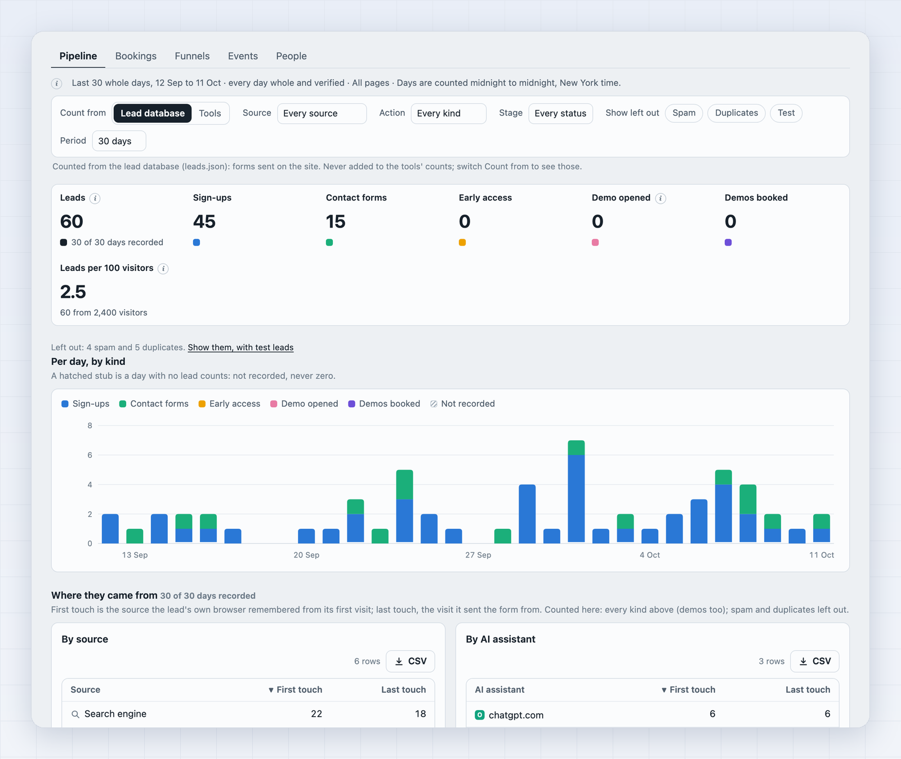
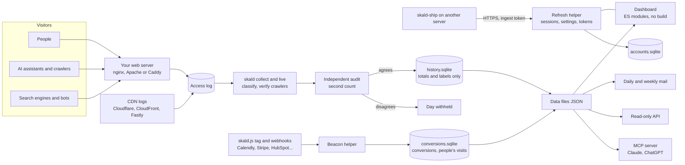

<p align="center">
  
</p>

<h1 align="center">Skald</h1>

<p align="center"><sub>Say it “skawld” (/skɔːld/), one syllable, rhymes with “called”: an old Norse poet who told what happened.</sub></p>

<p align="center">
  <strong>Every visit, truly told.</strong><br>
  Web analytics from your server's own access log: the people, the AI assistants and the crawlers<br>
  that a JavaScript tracker never sees. Every figure is counted twice, by an independent audit.<br>
  No cookies, nothing needed in the visitor's browser. Self-host it free, or try hosted Skald in beta.
</p>

<p align="center">
  <a href="LICENSE"></a>
  
  
  <a href="https://github.com/spcaeo/skald/actions/workflows/ci.yml"></a>
  <a href="https://github.com/spcaeo/skald/pkgs/container/skald"></a>
  <a href="https://github.com/spcaeo/skald/releases/latest"></a>
</p>

<p align="center">
  <a href="https://spcaeo.github.io/skald/"></a>
  <a href="https://skaldanalytics.com/beta/"></a>
</p>

<p align="center">
  <a href="https://spcaeo.github.io/skald/"><strong>Live demo</strong></a> ·
  <a href="#quick-start-in-60-seconds"><strong>Quick start</strong></a> ·
  <a href="#whats-new">What's new</a> ·
  <a href="#see-it">Screenshots</a> ·
  <a href="#how-skald-compares">Comparison</a> ·
  <a href="docs/INSTALL.md">Install guide</a> ·
  <a href="SECURITY.md">Security</a> ·
  <a href="#faq">FAQ</a> ·
  <a href="#hosted-skald-and-commercial-licences">Hosted beta / commercial</a>
</p>

<p align="center">
  <picture>
    <source media="(prefers-color-scheme: dark)" srcset="docs/screenshots/hero-dark.png">
    <source media="(prefers-color-scheme: light)" srcset="docs/screenshots/hero-light.png">
    
  </picture>
</p>

---

## What's new

- **2.16.0: connect a site in a few guided steps** ([changelog](CHANGELOG.md#2160-2026-10-21)).
  Settings > Connections sends a site's visits to Skald, reads your figures (API) or connects an
  AI assistant, each as a short dialog with everything filled in and a **Test** at the end. Add a
  site in five steps you can leave and resume. An install kit with a check script that says what
  is wrong in plain words, and a private link to share the steps with your developer.
- **2.15.0: shortened IP addresses and the wording for your privacy notice**
  ([changelog](CHANGELOG.md#2150-2026-10-20)).
- **2.14.0: AI answers** ([changelog](CHANGELOG.md#2140-2026-10-18)). What ChatGPT, Perplexity,
  Gemini and Claude answer to your customers' questions, per tracking profile (a place and a
  language): whether they name you, the pages they cite, the competitors they name, and the
  chain only your log can show: cited → read → sent → leads. A cost estimate before anything runs
  and a daily cap; it needs each provider's API key. A sample of API answers, labelled so.
- **2.13.0: a new Overview and Visitors; first touch and cities; search, reports, retention and
  crawl health; advanced filters** ([changelog](CHANGELOG.md#2130-2026-10-18)). Today on one live
  page, each figure against yesterday at this hour. Each visit with its city and where the
  visitor first came from, and one visitor drawer that replays their journey. Google Search
  Console's and Bing's queries, impressions and position, synced every 6 hours. Branded client
  reports with a PDF. Retention cohorts. Which sitemap pages each crawler reaches. Filters with
  AND, OR and groups, saved as views, and sort, column filters, columns and export on every table.
- **2.11.0: real time, on a world map; AI alerts in Slack** ([changelog](CHANGELOG.md#2110-2026-10-18)).
  Who is on your site now, minute by minute, on a live world map, with the pages being read and
  the AI and crawlers fetching right now, every figure counted twice. Alerts for an assistant's
  first citation, a page's first, AI-answer visits against the usual for that weekday, and a
  crawler gone silent, sent to Slack or any webhook. "Direct" and "Not recorded" instead of
  "unknown".
- **2.10.0: what AI reads, asks for and costs** ([changelog](CHANGELOG.md#2100-2026-10-18)). What
  an assistant read just before it sent you a visitor. What AI fetches ask for: pages, `llms.txt`,
  Markdown, `robots.txt`, sitemaps. Google's AI Mode told apart. What each crawler costs your
  server, with a detail view per crawler.
- **2.9.0: the script tag on every site of one install** ([changelog](CHANGELOG.md#290-2026-10-18)),
  each site's events kept and audited apart. Google Ads clicks from iOS read as paid.

[Full changelog](CHANGELOG.md) · [All releases](https://github.com/spcaeo/skald/releases)

## Your analytics cannot see the new visitors

More and more people ask ChatGPT, Claude or Perplexity before they visit a website. When they do,
the assistant fetches your pages to write its answer. AI companies also crawl your site to train
their models. **None of that runs JavaScript, so Google Analytics, Plausible and other script-based
tools never count it.** Google Analytics also drops known bots on purpose.

Skald reads the one record that sees every visit: **your web server's access log.** Every request
lands in exactly one of five groups, and the five add up to the log exactly.

| Group | What is in it |
| --- | --- |
| **People** | A browser that is none of the groups below. Self-reported, so an upper bound. |
| **AI assistants** | Split by why they came: to train, because someone just asked a question, or a person who clicked a link in an AI answer. |
| **Search engines** | Google, Bing and other classic indexing. |
| **Bots and scanners** | Monitors, SEO tools, chat link previews, and probes hunting for `.env` or `wp-login`. |
| **Your own traffic** | Your team, your crawler, your tests. Kept apart, never counted as people. |

How much of your traffic is AI assistants reading your pages? Only your server's log can say, and
Skald's first run answers it for your own site, from the log you already have.

## Why Skald

<table>
<tr>
<td width="50%" valign="top">

### See AI assistants and crawlers
GPTBot, ClaudeBot, PerplexityBot, ChatGPT-User and the rest, by name, with the pages they fetched.
Each AI request is filed by **why it came**: training, answering someone live, or a person clicking
a citation. The three never double count. See what each one asks for (`llms.txt`, Markdown, pages),
what it costs your server, and what an assistant read just before it sent you a visitor.

</td>
<td width="50%" valign="top">

### Trust the names
A crawler's claim is checked against its owner's published addresses or DNS (Google, Bing, Apple,
OpenAI, Perplexity, Anthropic, DuckDuckGo, Meta; DNS for others). A fake is filed apart as
*"claims to be GPTBot"*.

</td>
</tr>
<tr>
<td valign="top">

### Every figure counted twice
A separate audit recounts every figure from the raw log with its own parser and rules. If the two
counts disagree, **the day is withheld, never guessed**. A missing day is never drawn as zero, and
a figure that was not recorded stays blank.

</td>
<td valign="top">

### Private by design, yours to set
No script and no cookie are needed in the visitor's browser, and everything stays on your server.
History keeps totals and labels. Whether each visit keeps its IP address and each lead its email is
a setting: on for a new install, off on an upgraded one until you turn it on. One command deletes a
person everywhere.

</td>
</tr>
<tr>
<td valign="top">

### Live, not 48 hours late
**Real time** shows who is on the site now, on a world map, with the pages being read and the AI
and crawlers fetching right now. **Today · Live**, in the top bar of every tab, shows today so far,
redrawn every 2 minutes. The last 6 hours can be read request by request, each with the rule that
put it in its group, in words. Alerts show on the dashboard, by email, or in Slack.

</td>
<td valign="top">

### Results, not just visits
Leads, funnels and conversions, in one section with one row of options. Leads and demos booked
also sit beside the traffic where they help: Overview, Sources, Pages, Places & devices and
Insights, with a lead rate per source, page and country. Calendly, Cal.com, Stripe, Typeform,
HubSpot and Zapier push signed webhooks; the optional `skald.js` tag adds clicks, form steps and
bookings, on every site of the install. Checked twice like everything else.

</td>
</tr>
<tr>
<td valign="top">

### Find the AI traffic hiding in "Direct"
A click from a ChatGPT or Perplexity answer often arrives with no referrer, so other tools file it
under "Direct". When someone asks an assistant, it fetches your page first, and Skald sees that
fetch. A direct visit landing on that same page minutes later is shown as **likely from that
assistant**: for visits, leads and conversions. Always labelled "likely", never mixed into the real
counts, and counted twice.

</td>
<td valign="top">

### Works where your site lives
Your own server's log, or the host's: **Vercel and Netlify log drains**, a **Cloudflare Worker**
that reports pages served from cache on any plan, CloudFront and Fastly logs, or a small shipper
from any server. Settings > Connections walks you through each one, with an install kit and a
**Test connection** button; step by step for Vercel: [docs/VERCEL.md](docs/VERCEL.md).

</td>
</tr>
<tr>
<td valign="top">

### Follow one person across days
Search an IP address, an email or a lead and see that person's visits on every day kept (source,
landing page, pages in order, country, device), and their leads and conversions, linked by visitor
ID and email. An address is tied to a lead by the form it sent at the lead's time: likely, never
certain. For admins and owners; every search is in the audit log.

</td>
<td valign="top">

### Nothing hidden, and setup that checks itself
Spam, duplicate and test leads, and cancelled, removed and test conversions, are listed in full,
never just dropped. `skald doctor` checks every part of the install, one line each, with the exact
fix; Settings > Integrations shows the same for each hook and the script tag.

</td>
</tr>
</table>

## Features

**The dashboard**
- Five sections, with tabs inside: Overview, Traffic, Leads & sales, AI & bots and Site. Each
  answer has one place.
- **Today · Live** and **Compare with…** in the top bar, on every tab.
- **Real time** (Overview › Real time, and the top of Summary in Live mode): visitors active now and
  in the last 30 minutes, visitors minute by minute, requests per minute (labelled requests, never
  people), pages being read, sources, devices, AI assistants and crawlers now, and the newest
  visits. Visitors every 2 minutes with the same rules as every figure; requests every 15 seconds;
  both recounted by the audit.
- A **world map** of where visitors are: countries shaded by visits today, a bubble where visitors
  are active now, keyboard and click to a country's detail, a countries table beside it. Natural
  Earth's public-domain outlines drawn in the page; no map service is asked for anything.
- Nothing reads "unknown": a visit with no referrer and no campaign tag is **Direct**, a value the
  log did not have is **Not recorded**.
- **Overview, today, live:** visitors now, arrivals minute by minute, and the four tiles against
  **yesterday at this hour** (a figure with its own second count), the map, the newest visits,
  sources, what converted and AI & bots, each card linking to its tab.
- **Every table works the same way:** sort any column, filter columns (contains, a range, pick
  values), choose columns, and export just the rows and columns you see. All of it stays in the
  address, so a link opens the same view. Every row opens its detail. Old links redirect.
- **Advanced filters:** rules on any field a visit carries (country, city, source, campaign, AI
  assistant, first came from, pages, time on site, lead, device, browser, new or returning) with
  is, is not, contains, at least, at most, All or Any, and groups; a live count of matching visits;
  saved as views, renamed, or copied as a link. A value not recorded never matches by chance.
- **Search the dashboard** (Ctrl K): pages, countries, sources, assistants and crawlers in the
  period, each opening on its tab.
- Countries as a flag and a three-letter code everywhere (the full name on hover and in the CSV);
  dates in the site's time zone; a first-run checklist for a new site; a preview of the daily mail.

**Traffic and audience**
- Five groups that add up to the log, every day, every site.
- Visitors, visits, pages read, countries (with a flag beside each, everywhere), browsers, systems,
  devices, sources, referring sites, UTM campaigns and ad networks (from the click ID, never its value).
- AI assistants' phone apps count as citations; paid social, iOS Google Ads, TikTok and X clicks
  are told apart by their tags and click IDs.
- Calls under `/api/` (a site's own JSON API) are evidence of a visit, never a page view.
- A new outside source starts a new visit: someone who opens the site directly and comes back from
  ChatGPT minutes later is two visits, the second from ChatGPT, so an AI assistant's visit is never
  hidden inside an earlier one.
- Anonymous journeys: each visit's pages in order, kept 7 days by default.
- **Traffic › Visitors:** the visitor flow, each visit with its city and source, real new and
  returning figures and how engaged visits were (narrowed by the filters when every kept visit
  checks out), each card withheld unless it adds up.
- **Where a returning visitor first came from** (first touch): under a Direct visit, "First came
  from google.com, 3 days ago", linked by the visitor ID, the kept address or the 30-day code,
  never guessed; on Sources, every returning visit by where it first came from, counted twice.
- **One visitor drawer:** every visit of a visitor as a timeline, the time between pages, "12 days
  later" between visits, and a Replay of the journey. Admins and owners, audit-logged.
- **Cities** from a GeoIP city file you give it (`SKALD_CITY_DB`; DB-IP's free city file works):
  a Cities table, the city on each visit, and a dot per active city on the live map. People only.
- **Retention cohorts** (Traffic › Retention): of the visitors first seen in a week, how many came
  back in each week after, split by first source, country, device or landing page.
- **Search Console and Bing** (Traffic › Search): queries, pages, countries, devices, clicks,
  impressions, CTR and position, synced every 6 hours, connected from Settings without a shell, and
  set beside Skald's own visits from search, never forced to match.
- A visit that opens 6 or more pages within 2 seconds is too fast to be a person and counts as a bot.
- People: each visit kept with its IP address and browser (395 days by default), and one search for
  an IP, an email, a lead or a visitor ID that shows that person's visits, leads and conversions
  across days, linked. Admins and owners only, every search in the audit log. Keeping IPs and emails
  is a setting: on for a new install, off on an install upgraded from before 2.4.0.
- Engagement by source and device (pages per visit, one-page visits, visit length), returning
  visitors by source, exit rate per page.
- Campaign tag problems flagged: a source with no medium, an unrecognised medium, an ad click with no
  tags, tags on internal links.
- **Compare with…** in the top bar: the previous period, the same period last year, or any range
  up to 12 months, as A, B and the change on every tab that compares, leads and demos booked included. Insights
  (working, dropped, new, gone), and a page's story: its first Googlebot, first AI crawler, first
  person and first lead.

**AI and machines**
- AI assistants by name and by reason, with the pages each one fetched.
- What the AI read before it sent a visitor: the pages that assistant fetched in the minutes
  before the click, in the visit itself and per assistant (how many of its visits landed on a page
  it had just read). Context, never a count of people.
- What AI fetches ask for: pages, `llms.txt`, Markdown, plain text, `robots.txt`, sitemaps or other
  files, for training and for live answers apart.
- What each crawler costs your server: requests, data sent, mean and 90th-percentile response time,
  error share, distinct paths and re-crawls, per assistant, search crawler and bot. Open one for
  its detail: requests by day, pages, statuses, the share from its owner's checked addresses,
  countries, user agents and when it was last seen.
- Google's AI Mode told apart: a click from Google that carries AI Mode's `udm=50` reads
  "google.com (AI Mode)", still under Search engine. Only when Google says so, never guessed.
- AI clicks that lost their referrer, estimated: a direct visit to a page an assistant fetched
  minutes before is shown as "likely" from that assistant, on AI & bots and on Leads & sales.
  Kept apart, never added to any count.
- Crawler verification, fake crawlers filed apart.
- Block AI crawlers per assistant, or only their training crawlers (AI & bots > Crawler rules),
  applied by the web server (`robots.txt` stays reachable). Skald blocks; it does not charge.
- Your `robots.txt` rules shown beside what each crawler actually fetched.
- **Crawl health:** your sitemap beside what Google, Bing and each AI crawler fetch: coverage,
  sitemap pages never fetched, pages fetched that the sitemap does not list, errors, redirects,
  slow and large answers.
- AI alerts: an assistant starts or stops reading a page, or the visits it likely sends jump or
  vanish; the first visit ever from an assistant's answer, a page's first, visits from AI answers
  against the median of the same weekday over 6 weeks (the rule and each week's figure in the
  alert), and an AI or search crawler gone silent for 7 days. Visits or requests, never mixed.
  Whole, checked days only, and each alert's figures recounted.
- A suggested `llms.txt` from the pages people and assistants read most, to copy and publish
  yourself.
- **AI answers:** what ChatGPT, Perplexity, Gemini and Claude answer to the questions your
  customers ask, asked through their APIs with your own keys, per **tracking profile** (a place
  and a language; daily, weekly or monthly; 1 to 5 tries a question). Whether each answer names
  you, which of your pages it cites, which competitors it names, run by run and as "x of N
  tries"; then **cited → read → sent → leads** for one page, from your own log and lead tools.
  A cost estimate before anything runs and a daily cap; every figure recounted, a run that
  disagrees withheld. A sample of API answers, labelled so, not what every user sees.

**Results**
- One section, **Leads & sales**: Pipeline, Bookings, Funnels, Events and People. Pipeline's one row
  of options: count from your lead database (the default) or from your tools, never both in one
  figure; source, action, stage, show what was left out, and the period.
- Leads and demos booked on the Overview (two tiles, and each day's leads as dots on the main
  chart), and today's leads and bookings as they arrive with Today · Live.
- A Leads column and a lead rate (leads per visitor, from 10 visitors up) on Sources, Pages and
  Places & devices; lead findings in Insights; leads against another period (Compare with…).
- Leads by first and last source, crossed with the status your team set, and time from first
  visit to lead.
- Saved funnels counted every day by source and device, with drop-off and time to go through.
- Conversions from signed webhooks; forms and bookings started but not finished.
- One Calendly or Cal.com account that books for several businesses: keep only your own event types.
- Goals from in-page events, per 100 visits by source.
- Spam, duplicate and test leads, and cancelled, removed and test conversions, each listed in full.
  A lead-database sync that takes a row away keeps it, with when and why; a test row is marked
  from the command line, listed and never counted.
- Outgoing signed webhooks to your CRM, Zapier or Slack, never with a name or email.

**Site**
- Health, Alerts, Requests, Not found, Speed and Data quality, as tabs of one section.
- 404s and who met them (people, probes, crawlers), server errors by page, page speed, uptime from
  the heartbeat with every outage.
- Alerts: site down, logging stopped, 5xx burst, 404 surge, crawler burst, new crawler, traffic
  drop. A failed morning run sends one short mail. Any alert can go to **Slack** (an incoming
  webhook gets Slack's own message shape) or any tool, as the signed webhook event `alert.opened`.
- Alerts switched on or off per site, with their mail and each rule, on Site › Alerts.
- A data-quality panel: unreadable lines, gaps, duplicates, log age.
- Deploy and change markers on every chart.

**Team, data and agents**
- Accounts: organisations, owner/admin/viewer roles, invites, two-step sign-in, scoped API tokens
  and an audit log. Or a single nginx password, if that is all you need.
- Settings in the dashboard: retention windows, what is kept about people, mail, sites, internal
  addresses, integrations (with each road's status), security.
- `skald doctor`: one line per part (daily run, missing days, logs, the dashboard, the hook
  receiver, each hook's secret and last delivery, the script tag, mail, a newer version, disk), each
  with its fix. A daily run that held back names the step and why.
- Several sites in one install, each with its own settings and its own logo. After sign-in, a
  card per site: its logo, a Live dot, and today's visitors, leads and demos booked ("-" when a
  figure is not known yet, never 0). The same logo is on the menu's site button, in the site
  switcher and on the browser tab. It comes from the site itself (its app icon, then its favicon;
  never an outside icon service), from an upload, or is the site's first letter on a colour
  (Settings > Sites > Logo). Each site names its own page assets (a WordPress site's
  `/wp-content/`, a Next.js site's `/_next/static/`) and has its own visitor IDs switch, and
  settings and sites can be changed from the shell too (`skald settings`, `skald site hosts`,
  `skald site remove`).
- Export any table as CSV or JSON, print to PDF, a report builder, and daily and weekly email
  reports (refused if the figures do not add up).
- **Client reports:** branded reports for an agency's clients, a mail with a PDF attached, weekly,
  monthly or every few days, with your name, colour and logo; verified days only, the sums counted
  twice before a report goes.
- A read-only JSON API and an **MCP server with 14 read-only tools** for Claude, ChatGPT and other
  AI agents (the person search only with a token that may read private data).
- In-app Help in plain words, with four how-to guides (pick your road, send leads from your backend
  in 5 minutes, demo bookings, Docker first install), keyboard shortcuts, a command palette, light
  and dark themes, and a phone layout.
- A notice when a new release is out, and one-command upgrades with a backup and a rollback.

**Inputs**
- nginx and Apache logs (combined or extended), Caddy JSON.
- Countries from the log (Cloudflare's country, or nginx's `cc=`). A log without one (Caddy, a plain
  combined log) gets each address's country from a GeoIP file you give it (`SKALD_COUNTRY_DB`;
  DB-IP's free country file works, and its credit is shown). Without one, Not recorded, never guessed.
  A city file (`SKALD_CITY_DB`) adds each visit's city the same way.
- CDN logs: Cloudflare Logpush, CloudFront, Fastly. Pages served from the CDN cache are counted too.
- Vercel and Netlify log drains, and the Skald Worker for Cloudflare on any plan (it posts each
  request after the page has gone out; with your server's log, only cache hits are kept).
- `skald-ship`: one standard-library Python file that sends another server's log to Skald.
- Beacon-only mode for a site with no readable log (it then sees people only, since bots run no
  script).

## See it

<p align="center">
  <a href="https://spcaeo.github.io/skald/"><strong>Try the live demo: sample data, no sign-up.</strong></a>
</p>

The whole dashboard with 60 days of sample data for a made-up site, in your browser: today's Overview,
the visitor drawer, cities, retention and crawl health, AI answers (made-up answers), Real time with its world map, AI & bots, flags, leads and bookings, the left-out leads and the removed conversions included.
Nothing to install. Settings, saving and the person search need your own Skald.

### New in 2.16.0: connect a site, step by step

<p align="center">
  <br>
  <strong>Connections.</strong> Three tasks, each a short guided dialog with a Test at the end.
</p>

| | |
| :---: | :---: |
| <br>**Install, filled in.** The kit, the commands, and a private link for your developer. | <br>**Add a site in five steps.** Close it any time; it continues where you left off. |

<p align="center">
  <br>
  <strong>Set up this site.</strong> Every open line has a Set up button that walks you through it.
</p>

### New in 2.14.0: AI answers

<p align="center">
  <br>
  <strong>AI answers.</strong> What the assistants say, and what they then read and sent.
</p>

| | |
| :---: | :---: |
| <br>**Tracking profiles.** A place and a language each, the cost before it runs. | |

### New in 2.13.0

<p align="center">
  <br>
  <strong>Overview, today.</strong> Live, and every figure against yesterday at this hour.
</p>

| | |
| :---: | :---: |
| <br>**One visitor, every visit.** Where they first came from, and the journey, replayable. | <br>**Advanced filters.** AND, OR and groups on any field; saved as views. |
| <br>**Cities.** Each visit's city, from a free city file. | <br>**Traffic › Search.** Google's and Bing's own queries, synced every 6 hours. |
| <br>**Retention.** Who came back, week by week, counted twice. | <br>**Crawl health.** Which sitemap pages each crawler reaches, and which it never does. |
| <br>**Client reports.** Branded, scheduled, with a PDF; verified days only. | |

### New in 2.11.0: real time

<p align="center">
  <br>
  <strong>Real time.</strong> Who is on the site now, minute by minute, and where on the map. Visitors and requests kept apart, both counted twice.
</p>

### New in 2.10.0: what AI reads, asks for and costs

| | |
| :---: | :---: |
| <br>**What the AI read before it sent a visitor.** Per assistant: visits from its answers, and how many landed on a page it had just fetched. | <br>**What AI fetches ask for.** Pages, `llms.txt`, Markdown, `robots.txt`, sitemaps, per crawler. |
| <br>**What each crawler costs.** Requests, bytes, response time, errors and re-crawls, every crawler side by side. | <br>**One crawler in detail.** By day, pages, statuses, the address check (impostors filed apart), user agents. |
| <br>**AI & bots › Assistants.** Who read your pages to answer someone, and who came from it. | <br>**What each assistant costs.** ChatGPT, Perplexity and Claude fetching live for a user. |

### The rest of the dashboard

| | |
| :---: | :---: |
| <br>**Overview.** The period at a glance, five groups that add up. | <br>**Today · Live.** One switch, on every section. |
| <br>**Compare with…** Previous period, last year or any period, on every section. | <br>**Traffic › Sources.** One grid; search, filters and sort kept in the address. |
| <br>**Leads & sales › Pipeline.** One row of options, every lead by stage. | <br>**Bookings.** Every stage, cancelled and removed ones too. |
| <br>**Live leads.** Each lead and booking as it lands. | <br>**Conversions.** Started, completed, abandoned. |
| <br>**Funnels.** Saved once, counted every day. | <br>**Visitors.** Each visit, page by page, a flag beside every country. |
| <br>**MCP in Claude.** Ask about your traffic in plain words. | <br>**Person search.** One address: every visit kept, across days, and the leads it sent. |
| <br>**One lead, linked.** Its email, address, visitor ID, form visit and conversions. | <br>**Left out, still listed.** Spam, duplicates and test, never just dropped. |
| <br>**Removed, with when and why.** Cancelled, removed and test conversions. | <br>**Integrations status.** Each road: working, or what to fix. |
| <br>**Shortened addresses.** Full, shortened or none: country and city still work. | <br>**Privacy-notice wording.** Made from what the site really keeps; copy and paste. |
| <br>**`skald doctor`.** Every part checked; a held-back run names its step. | <br>**Team & access.** Roles, invites, two-step sign-in. |
| <br>**Integrations.** Signed webhooks from the tools you use. | <br>**Choose a site.** Each site's logo and today so far. |
| <br>**Site switcher.** Every site with its logo, one click away. | <br>**Site logo.** From the site, an upload, or a letter on a colour. |
| <br>**Help.** Every page explained, and four how-to guides. | |

<p align="center">
  <br>
  <em>On a phone: the same figures, the site's logo and name in the top bar, a drawer menu and a bottom bar.</em>
</p>

## Quick start in 60 seconds

You need a server whose access log Skald can read. Full guide, all options and troubleshooting:
**[docs/INSTALL.md](docs/INSTALL.md)**. Hosting choices (Railway, Render, Fly.io, a VPS) and how to
measure sites on Vercel, Netlify or Cloudflare: **[docs/HOSTING.md](docs/HOSTING.md)**. Site on Vercel? Follow **[docs/VERCEL.md](docs/VERCEL.md)**.

**Hosting:** [](https://render.com/deploy?repo=https://github.com/spcaeo/skald)
(a paid instance with a disk; `render.yaml` sets it up). Railway, Fly.io and Kubernetes:
step by step in [docs/HOSTING.md](docs/HOSTING.md). A one-click Railway button comes once a
Railway template is published.

### Option 1: Docker (fastest)

**1. Start it** with your web server's log mounted read-only:

```sh
docker run -d --name skald -p 127.0.0.1:8080:8080 \
  -v /var/log/nginx:/logs:ro \
  -v skald-data:/var/lib/skald \
  ghcr.io/spcaeo/skald:latest
```

**2. Open** `http://localhost:8080`. The port is published on this machine only. To reach it from
elsewhere, put HTTPS in front: your web server proxying to `127.0.0.1:8080`, or the bundled Caddy
(Option 2). [docs/INSTALL.md](docs/INSTALL.md) has both recipes.

**3. Make the first owner.** This prints a link to set your password:

```sh
docker exec -it skald skald accounts init --org "Example Co" --owner-email owner@example.com
```

**4. Open the link, set a password, sign in.** Your history lives in the `skald-data` volume.

**5. Fill the history and check it.** `docker exec skald skald backfill --days 14` adds the days your
logs still hold; `docker exec skald skald doctor` then says, one line per part, what works and
what to fix. The full walk-through is the Help guide "Docker: first install in 10 minutes".

Settings come from environment variables (`SKALD_SITE`, `SKALD_HOSTS`, `SKALD_TIMEZONE`,
`SKALD_BASE_URL`, `SKALD_EMAIL`, `SKALD_SMTP_*`, `SMTP_USER`, `SMTP_PASSWORD`, `SKALD_KEEP_IPS`,
`SKALD_IDENTITY`) or a config file mounted at `/etc/skald/config.yml`. The
log must be readable by group `adm` (gid 4), as it is on stock Debian and Ubuntu.

> **Sign-in needs HTTPS.** The session cookie is `Secure`, so plain `http://` works only at
> `localhost`. On a remote server, put HTTPS in front (below).

### Option 2: Docker Compose

```sh
git clone https://github.com/spcaeo/skald && cd skald
docker compose up -d
docker compose exec skald skald accounts init --org "Example Co" --owner-email owner@example.com
```

`docker-compose.yml` is at the root of the repository. Edit its log path first if your logs are
not in `/var/log/nginx`.

#### On a server with your own domain

Either let your host's nginx or Caddy proxy `/traffic*` to `127.0.0.1:8080` over HTTPS, or start the
bundled Caddy, which gets a certificate for you:

```sh
SKALD_DOMAIN=stats.example.com docker compose --profile https up -d
```

### Option 3: Install script (Debian, Ubuntu and similar)

The quick way, pinned to a release:

```sh
curl -fsSL https://raw.githubusercontent.com/spcaeo/skald/v2.7.0/install.sh | sudo bash -s -- --ref v2.7.0
```

This runs a script from the internet as root. To check it first, download the release and its
checksums, verify, then run it:

```sh
curl -fsSLO https://github.com/spcaeo/skald/releases/download/v2.7.0/skald-2.7.0.tar.gz
curl -fsSLO https://github.com/spcaeo/skald/releases/download/v2.7.0/SHA256SUMS
sha256sum --ignore-missing -c SHA256SUMS      # must print: skald-2.7.0.tar.gz: OK
tar -xzf skald-2.7.0.tar.gz && cd skald-2.7.0 && less install.sh && sudo ./install.sh
```

It installs into `/opt/skald`, with config in `/etc/skald` and data in `/var/lib/skald`, and puts
the `skald` command in `/usr/local/bin`.

Upgrading later: `sudo skald upgrade` (a backup, migrations, a health check, a rollback), update notices
and optional automatic upgrades, and the `:2` Docker tag: [docs/UPGRADING.md](docs/UPGRADING.md).

### Option 4: From source

```sh
git clone https://github.com/spcaeo/skald && cd skald && sudo ./install.sh
```

Then the daily run and the live panel come from one command (it runs as the `skald` user, with
`/etc/skald/config.yml`, so use `sudo`):

```sh
sudo skald check            # verify yesterday's figures; store nothing
sudo skald run-daily        # check, collect, audit, dashboard, mail (the cron entry)
sudo skald live             # "Today so far"; safe every 2 minutes
sudo skald version          # brand, version and release
```

**Needs:** Python 3.11 or newer (tested on 3.11 to 3.14; `install.sh` installs 3.11 on Ubuntu
22.04, which ships 3.10). Nothing else: the standard library is enough. PyYAML is used only if it
is already installed, and Pillow, if installed, turns fetched site icons into small PNGs. The account that runs Skald must be able
to read the log (on Debian and Ubuntu, the `adm` group).

## Integrations

**The script tag (optional).** One line in your page's `<head>` adds page views, form steps, phone,
mail and outbound clicks, 75% scroll, and Calendly, Cal.com and HubSpot meeting bookings. It is under
6 KB of plain JavaScript, served from your own site and posting to your own site. No third-party code,
no cookie by default, and Do Not Track and Global Privacy Control are respected. Every site on one
Skald can use it: each site's events go to that site, and visitor IDs are set per site.

```html
<script src="/traffic-js/skald.js" data-site="example.com" defer></script>
```

```js
skald('track', 'cta_click', {id: 'pricing_top'});   // your own events
skald('consent', true);                             // with data-consent="required"
```

**Incoming webhooks.** Each tool's own signature is checked on the raw body; a repeat changes nothing.
The receiver runs on every install, Docker or install script, with or without the script tag.

| Tool | What Skald records |
| --- | --- |
| Calendly, Cal.com | `demo`: booked, cancelled, rescheduled (Calendly also no-show); keep only your own event types when one account books for several businesses |
| HubSpot | meetings as `demo`, contacts and workflows as `contact`, deals as `deal` (`won` at closed-won) |
| Stripe | `paid` (a checkout paid) |
| Typeform | `contact` |
| Zapier, Make, n8n, any script | the signed `json` hook, any short action name |
| Your own server | the signed `lead` hook (sign-ups, contacts, trials) |

**Which road fits your site** (a form plugin, Next.js on Vercel, a Postgres backend, no code,
Calendly, Stripe, HubSpot) is in the Help guide "Pick your road"; "Send leads from your backend in
5 minutes" has signed examples in curl, Node, Python and PHP. Settings > Integrations shows each
road's state (ready, never received, last received 2 h ago) and flags a lead that arrived by two
roads, which would count twice. `skald doctor` on the server says the same, with the fix.

**Outgoing webhooks.** Signed, HTTPS only, never to a private address, retried five times over about
15 hours. They never carry a name or an email.

**Cloudflare on any plan.** The Skald Worker counts the pages Cloudflare serves from its cache. It
asks for your Skald's ingest address and the site's token, then needs your site's route; see
[docs/HOSTING.md](docs/HOSTING.md#cloudflare-on-any-plan-the-skald-worker).

[](https://deploy.workers.cloudflare.com/?url=https://github.com/spcaeo/skald/tree/main/deploy/cloudflare-worker)

**API.** A read-only JSON API over every dashboard figure, with revocable, scoped tokens
(`skald_<id>_<secret>`). See [docs/API.md](docs/API.md).

**MCP for AI agents.** 14 read-only tools: `overview`, `breakdown`, `top_pages`, `ai_activity`,
`leads`, `funnel`, `compare`, `page_story`, `live_today`, `data_quality`, `site_health`,
`conversions` (its `by` breaks completed actions and leads down by source, first touch, landing
page, country, campaign, device or tool), `list_sites` and, with the `read_private` scope only,
`find_person`. Answers call visits "an upper bound on people" and name every
withheld day. It cannot change anything.

```sh
claude mcp add --transport http skald https://stats.example.com/traffic-mcp \
  --header "Authorization: Bearer skald_<id>_<secret>"
```

Claude Desktop, ChatGPT (through the API) and any MCP client that can send a header work too. OAuth
sign-in is not offered yet. See [docs/MCP.md](docs/MCP.md).

## How Skald compares

Facts about other tools come from each vendor's own docs, pricing pages or source code, checked on
2026-10-07. Rows added after that date were not checked for other tools and say so. The full matrix,
with a source for every cell, is in **[docs/COMPARISON.md](docs/COMPARISON.md)**.

✓ yes · ◐ partly, or on some plans or setups · ✗ no, or not found in its docs · ? not confirmed on
the vendor's pages · – does not apply · nc = not checked

| | **Skald** | GA4 | Plausible | Umami ¹ | Matomo | PostHog | Cloudflare ² | GoAccess |
| --- | :---: | :---: | :---: | :---: | :---: | :---: | :---: | :---: |
| How it collects | Server access log | JS tag | JS snippet | JS tracker | JS tag, or log import | JS SDK | JS beacon; AI Crawl Control at the edge | Server access log |
| Nothing runs in the visitor's browser | ✓ | ✗ | ✗ | ✗ | ◐ | ✗ | ◐ | ✓ |
| Counts visitors with an ad-blocker | ✓ | ✗ | ◐ | nc | ◐ | ◐ | ✗ | ✓ |
| AI training crawlers (GPTBot, ClaudeBot) | ✓ | ✗ | ✗ | ✗ ³ | ◐ | ✗ | ✓ | ✓ |
| AI assistants fetching a page to answer someone | ✓ | ✗ | ✗ | ✗ ³ | ◐ | ✗ | ✓ | ✓ |
| People who clicked through from an AI answer | ✓ | ✓ | ✓ | ✓ | ✓ | ✓ | ◐ | ✗ |
| Splits AI traffic by why it came | ✓ | ✗ | ✗ | nc | ? | ✗ | ? | ✗ |
| Checks a crawler is who it claims to be | ✓ | – | – | nc | ? | – | ◐ | ✗ |
| Totals must add up, or the day is withheld | ✓ | ✗ | ✗ | nc | ✗ | ✗ | ✗ | ✗ |
| A second, independent recount of every figure | ✓ | ✗ | ✗ | nc | ✗ | ✗ | ✗ | ✗ |
| Events inside the page | ✓ ⁴ | ✓ | ✓ | nc | ✓ | ✓ | ✗ | ✗ |
| Funnels | ✓ | ✓ | ◐ | nc | ◐ | ✓ | ✗ | ✗ |
| Search queries, impressions, position | ✓ | ◐ | ◐ | nc | ◐ | ? | ✗ | ✗ |
| What AI assistants answer about you, per place and language | ✓ | nc | nc | nc | nc | nc | nc | nc |
| Ad cost and Google Ads link | ✗ | ✓ | ✗ | nc | ? | ? | ✗ | ✗ |
| Runs on your own server | ✓ | ✗ | ◐ | ✓ | ✓ | ◐ | ✗ | ✓ |
| Deleting one visitor on request | ✓ | ? | – | nc | ✓ | ? | – | ✗ |
| AI agents can query it (MCP) | ✓ | nc | nc | nc | nc | nc | nc | nc |
| Licence | ELv2 (source-available) | Closed, SaaS | AGPLv3 (Community Edition) | MIT | GPL | MIT (self-host) | Closed, SaaS | MIT |
| Price | Free to self-host | Free; 360 on request | From $9/month; self-host free | Cloud free to 100k events | Cloud from EUR 29/month; self-host free | 1M events/month free | Web Analytics free | Free |

<sub>¹ Umami is in the "Also checked" list of [docs/COMPARISON.md](docs/COMPARISON.md), not in its
full matrix; only its collection method, bot handling, AI referral channel, licence and price were
checked. ² Cloudflare Web Analytics (the beacon) together with AI Crawl Control, which needs your
traffic to pass through Cloudflare. ³ Umami excludes bots by default. ⁴ With the optional `skald.js`
tag or beacon.</sub>

### Where others lead (honestly)

- **Search itself.** Queries, impressions and ranking come only from Search Console and Bing
  Webmaster Tools. Keep them. A Search Console import is on Skald's roadmap.
- **Deep in-page analysis and ad spend.** GA4 and PostHog see far more inside the page, and GA4
  links to Google Ads. Skald's tag sends clicks, form steps and bookings, but no more.
- **Any host, any cache.** Script tools work anywhere. Skald needs a log: a page a CDN serves from
  its cache never reaches your server's log unless you feed Skald the CDN's own log.
- **Charging AI crawlers.** Cloudflare can charge per crawl. Skald can block, not charge.

### Who should use what

- **What people searched for, and where you rank:** Search Console and Bing Webmaster Tools.
- **Clicks, scrolls, funnels and ad spend inside the page:** GA4 or PostHog.
- **Simple cookie-free counts on any host:** Plausible.
- **Every visitor, crawler and AI fetch, with checked figures, on your own server:** Skald. It sits
  beside the tools above. Even the gap between Skald's count and GA4's is useful: it shows how much
  the script misses.

## Who it is for

- **Founders and marketers** who need to know whether ChatGPT, Claude and Perplexity read their
  site, and whether those answers send people and leads.
- **Agencies and SEO teams** who report AI visibility to clients and need figures that hold up.
- **Engineers and site owners** who want analytics with no third-party script, no cookie banner for
  counting, and data that stays on their own server.
- **Privacy-minded organisations** that must answer a deletion request with one command.

More in [docs/POSITIONING.md](docs/POSITIONING.md) and the story in
[docs/WHY-WE-BUILT-SKALD.md](docs/WHY-WE-BUILT-SKALD.md).

## Tech stack

| Layer | What it uses |
| --- | --- |
| Language | **Python 3.11+**, standard library only. No `pip install`. PyYAML and Pillow optional. |
| Storage | **SQLite**: `history.sqlite` (daily totals), `accounts.sqlite`, `conversions.sqlite`. One file each, easy to back up. |
| Dashboard | **Vanilla ES modules** and plain CSS. **No build step**, no framework, no third-party JavaScript, no web fonts, no request to anywhere else. A strict Content-Security-Policy. |
| Mail | Branded HTML reports with inline styles, plain-text alternative, nothing fetched from outside the mail. |
| Web server | **nginx** or **Caddy** in front for HTTPS (the Docker `https` profile adds Caddy with automatic certificates). The reference nginx setup adds a sign-in check with `auth_request` and rate limits. Reads nginx, Apache and Caddy logs. |
| Running | cron and systemd on a plain Linux server, or the **Docker** image. Two small local helpers on `127.0.0.1` (or a Unix socket). |
| Security | scrypt password hashes, HMAC-SHA256 for visitor keys and webhook checks, TOTP (RFC 6238) two-step sign-in. |
| Tests | 1,800+ tests, standard library `unittest`, exact numbers against hand-built logs. |

## Architecture



## Security and privacy

- **No addresses in history.** Stored history holds totals and labels only. Returning visitors use
  a keyed one-way hash, deleted after 30 days.
- **People, as a switch.** A new install keeps each visit with its IP address and browser
  (`privacy.keep_ips`, 395 days by default) and leads' names and emails (`conversions.identity:
  full`), apart from history and behind sign-in, so admins can follow a person across days. An
  install upgraded from before 2.4.0 keeps neither until you turn them on (Settings > Data
  retention > People, or `SKALD_KEEP_IPS=1` / `SKALD_IDENTITY=full`). Your privacy notice must say
  so first.
- **Shortened addresses** (2.15). Keep each visit's IP with its last part removed (203.0.113.57 is
  kept as 203.0.113.0; IPv6 keeps its first 48 bits): country, city and counts still work, and no
  exact address is kept (`privacy.keep_ips: short`, `SKALD_KEEP_IPS=short`). Counted twice too.
- **Wording for your privacy notice** (2.15). Settings > Data retention writes a short text for your
  privacy page from what the site really keeps, ready to copy. A starting point, not legal advice. Off, raw addresses stay only in your own log (14 days), the 6-hour request log (Site > Requests) and
  today's AI activity.
- **One true delete.** `skald forget` removes a person's address, visits, conversions, name and
  email everywhere Skald keeps them. Every person search is written to the audit log.
- **Webhooks keep only what counts.** Phone numbers, form answers, addresses and browser strings
  are dropped before anything is written; a name and email only when the site keeps them.
- **Signed everything.** Webhooks are checked against each tool's signature; outgoing hooks are
  signed and HTTPS only.
- **Hardened sign-in.** scrypt hashes, HttpOnly + Secure session cookie (only its SHA-256 stored),
  CSRF tokens, slow-down after failed sign-ins (no lock-out), optional TOTP, scoped tokens shown
  once, an audit log that never stores a password, token or address.
- **Two security reviews** were done on the 2.0 platform code (sign-in and sessions, sites, mail,
  webhooks) before this release, and their fixes are in it. For example, a site added in the
  dashboard must prove its domain before Skald collects for it.
- **Secrets stay out of the repo.** Secrets typed in the dashboard are write-only and kept in a
  `0600` file; SMTP logins come from an env file the config names.

Read **[SECURITY.md](SECURITY.md)** for what Skald stores, the hardening checklist and how to report a
vulnerability privately.

## FAQ

**Is Skald open source?**
Skald is **source-available** under the [Elastic License 2.0](LICENSE). You can read, use, change
and self-host it for free, for your own sites or your clients' sites, including at work. The one
thing you may not do without a commercial licence is offer Skald to others as a hosted or managed
service. Because of that limit, ELv2 is not an OSI-approved open-source licence, and we do not call it
one. Questions: [contact us](https://skaldanalytics.com/contact/?topic=licence).

**Can I use it for my agency's clients?**
Yes, if you run it for them. Selling access to a hosted Skald that others sign up for is the case that
needs a licence. If you are unsure, ask.

**Why do my numbers differ from Google Analytics?**
They count different things. GA4 counts browsers that run its script and accept it; ad-blockers and
refused consent hide many visits from it. Skald reads the log, so it sees those, plus AI and bots in
their own groups. Skald's "people" is an upper bound, because a browser's name is self-reported.

**Does it replace Google Analytics or Search Console?**
No. Keep Search Console for queries and ranking, and GA4 or PostHog for deep in-page analysis and ad
spend. Skald sits beside them.

**Can it tell me how often ChatGPT cites me?**
Partly. Skald sees each live fetch an assistant makes for a user's question, and each person who
clicks through, but not the answer the assistant gives. Clicks are a floor, because referrers are
often stripped. Clicks from Google AI Overviews look like ordinary Google clicks and cannot be told
apart.

**Does it count visitors who decline or ignore the cookie banner?**
Yes. Skald counts from your web server's own access log, and the server writes a line for every
request, whatever the visitor chose on the banner. Skald sets no cookie and stores nothing on the
visitor's device to count them. The optional script tag is the one part that follows the banner: it
can wait for consent (`data-consent="required"`), does nothing when Do Not Track or Global Privacy
Control is on, and keeps no visitor ID unless you turn IDs on. The log holds IP addresses, which are
personal data in places like the EU: you choose whether Skald keeps them in full, shortened (the last
part removed) or not at all, and for how long, and Settings > Data retention writes the wording for
your privacy notice.

**Does Skald keep IP addresses or emails?**
On a new install, yes: each visit with its IP address and browser (395 days by default), and a
lead's name and email, so an admin can follow one person across days. Both are settings (Settings >
Data retention > People). An install upgraded from before 2.4.0 keeps neither until you turn it
on; update your privacy notice first. Stored history never holds an address, and `forget` deletes a
person everywhere.

**Does it need cookies or a consent banner?**
Counting from the log needs no cookie and nothing in the browser. The optional tag sets no cookie by
default and can wait for consent. Signing in to the dashboard uses one session cookie for you. Your
own legal duties depend on your country and setup.

**What if my site is on Vercel, Netlify or a static host?**
Vercel and Netlify can send every request to Skald with a log drain (Vercel Pro, Netlify
Enterprise); step by step for Vercel: [docs/VERCEL.md](docs/VERCEL.md). Behind Cloudflare, use
Logpush or the Skald Worker. Otherwise use a CDN's log, ship the log from another server with
`skald-ship`, or use beacon-only mode (people only). See [docs/HOSTING.md](docs/HOSTING.md).

**What happens when the figures do not add up?**
The day is withheld: the dashboard says so, the mail for it is refused, and nothing is shown as zero.

**How heavy is it?**
A busy day's log takes about a second for the live view, and only today's files are opened. No
database server, no queue, no build step.

**Is there a hosted version?**
Yes, in beta. [Join the beta or start a 30-day free trial](https://skaldanalytics.com/beta/): we set
the account up for you within one working day, and no card is needed. Or run Skald on your own
server, free, with the quick start above.

## Roadmap

- Search Console import (queries, impressions, position beside Skald's own figures).
- An outside uptime check, beside today's same-server heartbeat.
- OAuth sign-in for MCP clients, so connector screens can add Skald without a header.
- Rotation of the returning-visitor key.
- More crawler owners verified (Baidu next).
- Counting refinements listed in [docs/ROADMAP.md](docs/ROADMAP.md): HEAD requests, `/pricing` equal to `/pricing/`,
  `%xx` decoding.
- Hosted Skald out of beta.

Have a need that is not here? [Open a feature request](https://github.com/spcaeo/skald/issues/new/choose).

## Contributing

Bug reports, fixes and docs are welcome. Two house rules matter most: **every new figure gets a
second, independent count**, and **no file grows past 1,000 lines**. Setup takes a minute because
there is nothing to install:

```sh
git clone https://github.com/spcaeo/skald && cd skald
python3 -m unittest discover tests
```

Read [CONTRIBUTING.md](CONTRIBUTING.md) (including the short contributor licence agreement) and the
[Code of Conduct](CODE_OF_CONDUCT.md). Changes are listed in [CHANGELOG.md](CHANGELOG.md).

## Hosted Skald and commercial licences

**Rather not run a server?** Hosted Skald is in beta at
**[skaldanalytics.com](https://skaldanalytics.com/beta/)**: 30 days free, no card, your account
ready within one working day. Or join the beta list and we will contact you.

**Want to offer Skald to your own customers as a service?** That needs a commercial licence from
Space-O Technologies. **[Talk to us](https://skaldanalytics.com/contact/?topic=licence)**.

## Licence

[Elastic License 2.0](LICENSE). Copyright 2026 Space-O Technologies. "Skald" and the Skald logo are
trademarks of Space-O Technologies; see [NOTICE](NOTICE).

## Author

<table>
<tr>
<td valign="top">

**Rakesh Patel** built Skald.

- CEO, Space-O Technologies: software development and AI engineering.
- CEO, [LabsMedia](https://www.labsmedia.com).

Skald began as a tool for one question on our own website: is AI reading us, and does it send
anyone? No tool could answer it from data we owned, so we built one.

</td>
</tr>
</table>

---

<p align="center">
  <strong>If Skald shows you something your analytics could not, give it a ⭐ star</strong> so others
  find it, and <strong>Watch → Releases</strong> to hear about new versions.<br>
  <a href="https://github.com/spcaeo/skald/stargazers">Star Skald on GitHub</a> ·
  <a href="https://github.com/spcaeo/skald/issues">Report an issue</a> ·
  <a href="https://github.com/spcaeo/skald/discussions">Ask a question</a>
</p>
