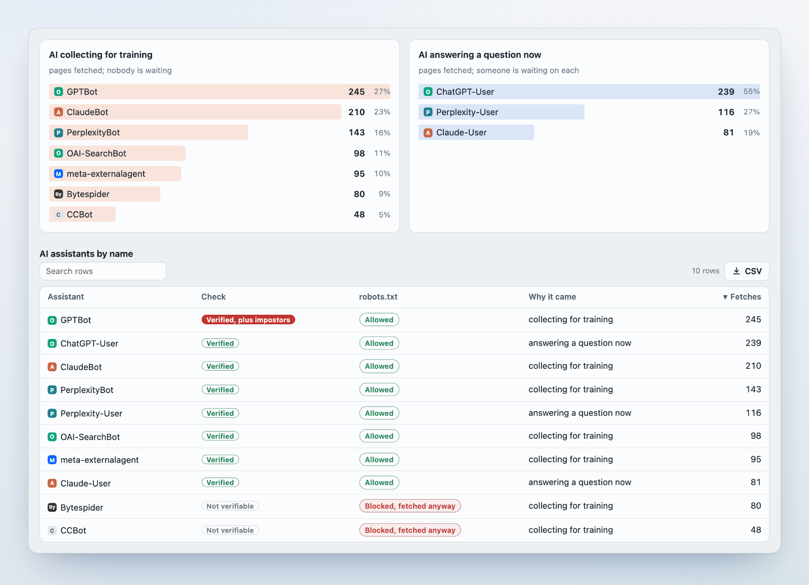
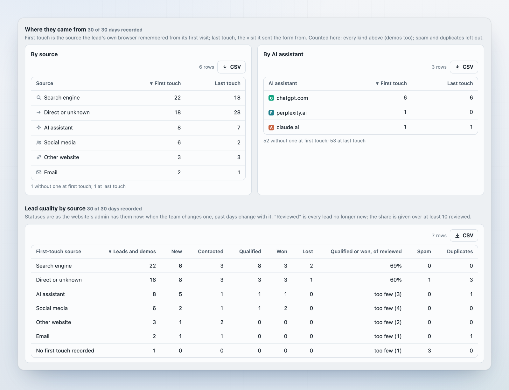
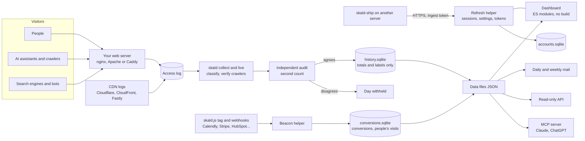

<p align="center">
  
</p>

<h1 align="center">Skald</h1>

<p align="center"><sub>Say it “skawld” (/skɔːld/), one syllable, rhymes with “called”: an old Norse poet who told what happened.</sub></p>

<p align="center">
  <strong>Every visit, truly told.</strong><br>
  Self-hosted web analytics that reads your server's own access log, so you see the people,<br>
  the AI assistants, the crawlers and the bots that a JavaScript tracker never sees.
</p>

<p align="center">
  <a href="LICENSE"></a>
  
  
  <a href="https://github.com/spcaeo/skald/actions/workflows/ci.yml"></a>
  <a href="https://github.com/spcaeo/skald/pkgs/container/skald"></a>
  
</p>

<p align="center">
  <a href="https://spcaeo.github.io/skald/"></a>
</p>

<p align="center">
  <a href="https://spcaeo.github.io/skald/"><strong>Live demo</strong></a> ·
  <a href="#quick-start-in-60-seconds"><strong>Quick start</strong></a> ·
  <a href="#see-it">Screenshots</a> ·
  <a href="#how-skald-compares">Comparison</a> ·
  <a href="docs/INSTALL.md">Install guide</a> ·
  <a href="SECURITY.md">Security</a> ·
  <a href="#faq">FAQ</a> ·
  <a href="#hosted-skald-and-commercial-licences">Hosted / commercial</a>
</p>

<p align="center">
  <picture>
    <source media="(prefers-color-scheme: dark)" srcset="docs/screenshots/hero-dark.png">
    <source media="(prefers-color-scheme: light)" srcset="docs/screenshots/hero-light.png">
    
  </picture>
</p>

---

## Your analytics cannot see the new visitors

More and more people ask ChatGPT, Claude or Perplexity before they visit a website. When they do,
the assistant fetches your pages to write its answer. AI companies also crawl your site to train
their models. **None of that runs JavaScript, so Google Analytics, Plausible and other script-based
tools never count it.** Google Analytics also drops known bots on purpose.

Skald reads the one record that sees every visit: **your web server's access log.** Every request
lands in exactly one of five groups, and the five add up to the log exactly.

| Group | What is in it |
| --- | --- |
| **People** | A browser that is none of the groups below. Self-reported, so an upper bound. |
| **AI assistants** | Split by why they came: to train, because someone just asked a question, or a person who clicked a link in an AI answer. |
| **Search engines** | Google, Bing and other classic indexing. |
| **Bots and scanners** | Monitors, SEO tools, chat link previews, and probes hunting for `.env` or `wp-login`. |
| **Your own traffic** | Your team, your crawler, your tests. Kept apart, never counted as people. |

How much of your traffic is AI assistants reading your pages? Only your server's log can say: a
script-based tool shows none of it. Skald's first run answers it for your own site, from the log you
already have, with every request in exactly one of these groups.

## Why Skald

<table>
<tr>
<td width="50%" valign="top">

### See AI assistants and crawlers
GPTBot, ClaudeBot, PerplexityBot, ChatGPT-User and the rest, by name, with the pages they fetched.
Each AI request is filed by **why it came**: training, answering someone live, or a person clicking
a citation. The three never double count.

</td>
<td width="50%" valign="top">

### Trust the names
A crawler's claim is checked against its owner's published addresses or DNS (Google, Bing, Apple,
OpenAI, Perplexity, Anthropic, DuckDuckGo, Meta; DNS for others). A fake is filed apart as
*"claims to be GPTBot"*.

</td>
</tr>
<tr>
<td valign="top">

### Every figure counted twice
A separate audit recounts every figure from the raw log with its own parser and rules. If the two
counts disagree, **the day is withheld, never guessed**. A missing day is never drawn as zero, and
a figure that was not recorded stays blank.

</td>
<td valign="top">

### Private by design, yours by default
No script and no cookie are needed in the visitor's browser. It runs on your server. History keeps
totals and labels, never addresses. Raw addresses live only in your log (14 days) and a 6-hour
private feed. One command deletes an address on request.

</td>
</tr>
<tr>
<td valign="top">

### Live, not 48 hours late
"Today so far" is redrawn every 2 minutes. The last 6 hours can be read request by request, each
with the rule that put it in its group, in words. Alerts show on the dashboard, and by email if you
want them.

</td>
<td valign="top">

### Results, not just visits
Leads, funnels and conversions. Calendly, Cal.com, Stripe, Typeform, HubSpot and Zapier push
signed webhooks; the optional `skald.js` tag adds clicks, form steps and bookings. Checked twice
like everything else. Nothing hidden: spam, test, cancelled and removed rows are listed, not lost.

</td>
</tr>
<tr>
<td valign="top">

### Find the AI traffic hiding in "Direct"
A click from a ChatGPT or Perplexity answer often arrives with no referrer, so other tools file it
under "Direct". When someone asks an assistant, it fetches your page first, and Skald sees that
fetch. A direct visit landing on that same page minutes later is shown as **likely from that
assistant**: for visits, leads and conversions. Always labelled "likely", never mixed into the real
counts, and counted twice.

</td>
<td valign="top">

### Works where your site lives
Your own server's log, or the host's: **Vercel and Netlify log drains**, a **Cloudflare Worker**
that reports pages served from cache on any plan, CloudFront and Fastly logs, or a small shipper
from any server. Step by step for Vercel: [docs/VERCEL.md](docs/VERCEL.md).

</td>
</tr>
</table>

## Features

**Traffic and audience**
- Five groups that add up to the log, every day, every site.
- Visitors, visits, pages read, countries, browsers, systems, devices, sources, referring sites,
  UTM campaigns and ad networks (from the click ID, never its value).
- Anonymous journeys: each visit's pages in order, kept 7 days by default.
- People: each visit kept with its IP address and browser (395 days by default; a switch), and one
  search for an IP, an email, a lead or a visitor ID that shows that person's visits, leads and
  conversions across days, linked. Admins and owners only, every search in the audit log.
- Engagement by source and device (pages per visit, one-page visits, visit length), returning
  visitors by source, exit rate per page.
- Campaign tag problems flagged: a source with no medium, an unknown medium, an ad click with no
  tags, tags on internal links.
- Compare any two ranges (up to 400 days each), Insights (working, dropped, new, gone), and a
  page's story: its first Googlebot, first AI crawler, first person and first lead.

**AI and machines**
- AI assistants by name and by reason, with the pages each one fetched.
- AI clicks that lost their referrer, estimated: a direct visit to a page an assistant fetched
  minutes before is shown as "likely" from that assistant, on Sources, Leads and Conversions.
  Kept apart, never added to any count.
- Crawler verification, fake crawlers filed apart.
- Block AI crawlers per assistant, or only their training crawlers, applied by the web server
  (`robots.txt` stays reachable). Skald blocks; it does not charge.
- Your `robots.txt` rules shown beside what each crawler actually fetched.
- AI alerts: an assistant starts or stops reading a page, or the visits it likely sends jump or
  vanish. Whole, checked days only.
- A suggested `llms.txt` from the pages people and assistants read most, to copy and publish
  yourself.

**Results**
- Leads by first and last source, crossed with the status your team set, and time from first
  visit to lead.
- Saved funnels counted every day by source and device, with drop-off and time to go through.
- Conversions from signed webhooks; forms and bookings started but not finished.
- Goals from in-page events, per 100 visits by source.
- Spam, duplicate and test leads, and cancelled, removed and test conversions, each listed in full.
- Outgoing signed webhooks to your CRM, Zapier or Slack, never with a name or email.

**Site health**
- 404s and who met them (people, probes, crawlers), server errors by page, page speed.
- Alerts: site down, logging stopped, 5xx burst, 404 surge, crawler burst, new crawler, traffic
  drop. A failed morning run sends one short mail.
- A data-quality panel: unreadable lines, gaps, duplicates, log age.
- Deploy and change markers on every chart.

**Team, data and agents**
- Accounts: organisations, owner/admin/viewer roles, invites, two-step sign-in, scoped API tokens
  and an audit log. Or a single nginx password, if that is all you need.
- Settings in the dashboard: retention windows, mail, sites, internal addresses, integrations,
  security.
- Several sites in one install, each with its own settings.
- Export any table as CSV or JSON, print to PDF, a report builder, and daily and weekly email
  reports (refused if the figures do not add up).
- A read-only JSON API and an **MCP server with 13 read-only tools** for Claude, ChatGPT and other
  AI agents.
- In-app Help in plain words, keyboard shortcuts, a command palette, light and dark themes, and a
  phone layout.
- A notice when a new release is out, and one-command upgrades with a backup and a rollback.

**Inputs**
- nginx and Apache logs (combined or extended), Caddy JSON.
- CDN logs: Cloudflare Logpush, CloudFront, Fastly. Pages served from the CDN cache are counted too.
- Vercel and Netlify log drains, and the Skald Worker for Cloudflare on any plan (it posts each
  request after the page has gone out; with your server's log, only cache hits are kept).
- `skald-ship`: one standard-library Python file that sends another server's log to Skald.
- Beacon-only mode for a site with no readable log (it then sees people only, since bots run no
  script).

## See it

**[Try the live demo](https://spcaeo.github.io/skald/)**: the whole dashboard with 60 days of sample
data for a made-up site, in your browser. Nothing to install; settings and saving need your own Skald.

| | |
| :---: | :---: |
| <br>**Overview.** The period at a glance, five groups that add up. | <br>**AI & crawlers.** Who came, why, and whether the name is true. |
| <br>**Leads.** By first and last source, AI assistants included. | <br>**Conversions.** Started, completed, abandoned. |
| <br>**Visitors.** Anonymous journeys, page by page. | <br>**Funnels.** Saved once, counted every day. |
| <br>**Team & access.** Roles, invites, two-step sign-in. | <br>**Integrations.** Signed webhooks from the tools you use. |
| <br>**MCP in Claude.** Ask about your traffic in plain words. | <br>**Help.** Every page explained, in plain words. |

<p align="center">
  <br>
  <em>On a phone: the same figures, a drawer menu and a bottom bar.</em>
</p>

## Quick start in 60 seconds

You need a server whose access log Skald can read. Full guide, all options and troubleshooting:
**[docs/INSTALL.md](docs/INSTALL.md)**. Hosting choices (Railway, Render, Fly.io, a VPS) and how to
measure sites on Vercel, Netlify or Cloudflare: **[docs/HOSTING.md](docs/HOSTING.md)**. Site on Vercel? Follow **[docs/VERCEL.md](docs/VERCEL.md)**.

**Hosting:** [](https://render.com/deploy?repo=https://github.com/spcaeo/skald)
(a paid instance with a disk; `render.yaml` sets it up). Railway, Fly.io and Kubernetes:
step by step in [docs/HOSTING.md](docs/HOSTING.md). A one-click Railway button comes once a
Railway template is published.

### Option 1: Docker (fastest)

**1. Start it** with your web server's log mounted read-only:

```sh
docker run -d --name skald -p 127.0.0.1:8080:8080 \
  -v /var/log/nginx:/logs:ro \
  -v skald-data:/var/lib/skald \
  ghcr.io/spcaeo/skald:latest
```

**2. Open** `http://localhost:8080`. The port is published on this machine only. To reach it from
elsewhere, put HTTPS in front: your web server proxying to `127.0.0.1:8080`, or the bundled Caddy
(Option 2). [docs/INSTALL.md](docs/INSTALL.md) has both recipes.

**3. Make the first owner.** This prints a link to set your password:

```sh
docker exec -it skald skald accounts init --org "Example Co" --owner-email owner@example.com
```

**4. Open the link, set a password, sign in.** Your history lives in the `skald-data` volume.

**5. Fill the history and check it.** `docker exec skald skald backfill --days 14` adds the days your
logs still hold; `docker exec skald skald doctor` then says, one line per part, what works and
what to fix. The full walk-through is the Help guide "Docker: first install in 10 minutes".

Settings come from environment variables (`SKALD_SITE`, `SKALD_HOSTS`, `SKALD_TIMEZONE`,
`SKALD_BASE_URL`, `SKALD_EMAIL`, `SMTP_*`) or a config file mounted at `/etc/skald/config.yml`. The
log must be readable by group `adm` (gid 4), as it is on stock Debian and Ubuntu.

> **Sign-in needs HTTPS.** The session cookie is `Secure`, so plain `http://` works only at
> `localhost`. On a remote server, put HTTPS in front (below).

### Option 2: Docker Compose

```sh
git clone https://github.com/spcaeo/skald && cd skald
docker compose up -d
docker compose exec skald skald accounts init --org "Example Co" --owner-email owner@example.com
```

`docker-compose.yml` is at the root of the repository. Edit its log path first if your logs are
not in `/var/log/nginx`.

#### On a server with your own domain

Either let your host's nginx or Caddy proxy `/traffic*` to `127.0.0.1:8080` over HTTPS, or start the
bundled Caddy, which gets a certificate for you:

```sh
SKALD_DOMAIN=stats.example.com docker compose --profile https up -d
```

### Option 3: Install script (Debian, Ubuntu and similar)

The quick way, pinned to a release:

```sh
curl -fsSL https://raw.githubusercontent.com/spcaeo/skald/v2.2.0/install.sh | sudo bash -s -- --ref v2.2.0
```

This runs a script from the internet as root. To check it first, download the release and its
checksums, verify, then run it:

```sh
curl -fsSLO https://github.com/spcaeo/skald/releases/download/v2.2.0/skald-2.2.0.tar.gz
curl -fsSLO https://github.com/spcaeo/skald/releases/download/v2.2.0/SHA256SUMS
sha256sum --ignore-missing -c SHA256SUMS      # must print: skald-2.2.0.tar.gz: OK
tar -xzf skald-2.2.0.tar.gz && cd skald-2.2.0 && less install.sh && sudo ./install.sh
```

It installs into `/opt/skald`, with config in `/etc/skald` and data in `/var/lib/skald`, and puts
the `skald` command in `/usr/local/bin`.

Upgrading later: `sudo skald upgrade` (a backup, migrations, a health check, a rollback), update notices
and optional automatic upgrades, and the `:2` Docker tag: [docs/UPGRADING.md](docs/UPGRADING.md).

### Option 4: From source

```sh
git clone https://github.com/spcaeo/skald && cd skald && sudo ./install.sh
```

Then the daily run and the live panel come from one command (it runs as the `skald` user, with
`/etc/skald/config.yml`, so use `sudo`):

```sh
sudo skald check            # verify yesterday's figures; store nothing
sudo skald run-daily        # check, collect, audit, dashboard, mail (the cron entry)
sudo skald live             # "Today so far"; safe every 2 minutes
sudo skald version          # brand, version and release
```

**Needs:** Python 3.11 or newer (tested on 3.11 to 3.14; `install.sh` installs 3.11 on Ubuntu
22.04, which ships 3.10). Nothing else: the standard library is enough. PyYAML is used only if it
is already installed, and Pillow, if installed, turns fetched site icons into small PNGs. The account that runs Skald must be able
to read the log (on Debian and Ubuntu, the `adm` group).

## Integrations

**The script tag (optional).** One line in your page's `<head>` adds page views, form steps, phone,
mail and outbound clicks, 75% scroll, and Calendly, Cal.com and HubSpot meeting bookings. It is under
6 KB of plain JavaScript, served from your own site and posting to your own site. No third-party code,
no cookie by default, and Do Not Track and Global Privacy Control are respected.

```html
<script src="/traffic-js/skald.js" data-site="example.com" defer></script>
```

```js
skald('track', 'cta_click', {id: 'pricing_top'});   // your own events
skald('consent', true);                             // with data-consent="required"
```

**Incoming webhooks.** Each tool's own signature is checked on the raw body; a repeat changes nothing.

| Tool | What Skald records |
| --- | --- |
| Calendly, Cal.com | `demo`: booked, cancelled, rescheduled (Calendly also no-show); keep only your own event types when one account books for several businesses |
| HubSpot | meetings as `demo`, contacts and workflows as `contact`, deals as `deal` (`won` at closed-won) |
| Stripe | `paid` (a checkout paid) |
| Typeform | `contact` |
| Zapier, Make, n8n, any script | the signed `json` hook, any short action name |
| Your own server | the signed `lead` hook (sign-ups, contacts, trials) |

**Which road fits your site** (a form plugin, Next.js on Vercel, a Postgres backend, no code,
Calendly, Stripe, HubSpot) is in the Help guide "Pick your road"; "Send leads from your backend in
5 minutes" has signed examples in curl, Node, Python and PHP. Settings > Integrations shows each
road's state (ready, never received, last received 2 h ago) and flags a lead that arrived by two
roads, which would count twice.

**Outgoing webhooks.** Signed, HTTPS only, never to a private address, retried five times over about
15 hours. They never carry a name or an email.

**Cloudflare on any plan.** The Skald Worker counts the pages Cloudflare serves from its cache. It
asks for your Skald's ingest address and the site's token, then needs your site's route; see
[docs/HOSTING.md](docs/HOSTING.md#cloudflare-on-any-plan-the-skald-worker).

[](https://deploy.workers.cloudflare.com/?url=https://github.com/spcaeo/skald/tree/main/deploy/cloudflare-worker)

**API.** A read-only JSON API over every dashboard figure, with revocable, scoped tokens
(`skald_<id>_<secret>`). See [docs/API.md](docs/API.md).

**MCP for AI agents.** Fourteen read-only tools: `overview`, `breakdown`, `top_pages`, `ai_activity`,
`leads`, `funnel`, `compare`, `page_story`, `live_today`, `data_quality`, `site_health`,
`conversions`, `list_sites` and, with the `read_private` scope only, `find_person`. Answers call visits "an upper bound on people" and name every
withheld day. It cannot change anything.

```sh
claude mcp add --transport http skald https://stats.example.com/traffic-mcp \
  --header "Authorization: Bearer skald_<id>_<secret>"
```

Claude Desktop, ChatGPT (through the API) and any MCP client that can send a header work too. OAuth
sign-in is not offered yet. See [docs/MCP.md](docs/MCP.md).

## How Skald compares

Facts about other tools come from each vendor's own docs, pricing pages or source code, checked on
2026-10-07. Rows added after that date were not checked for other tools and say so. The full matrix,
with a source for every cell, is in **[docs/COMPARISON.md](docs/COMPARISON.md)**.

✓ yes · ◐ partly, or on some plans or setups · ✗ no, or not found in its docs · ? not confirmed on
the vendor's pages · – does not apply · nc = not checked

| | **Skald** | GA4 | Plausible | Umami ¹ | Matomo | PostHog | Cloudflare ² | GoAccess |
| --- | :---: | :---: | :---: | :---: | :---: | :---: | :---: | :---: |
| How it collects | Server access log | JS tag | JS snippet | JS tracker | JS tag, or log import | JS SDK | JS beacon; AI Crawl Control at the edge | Server access log |
| Nothing runs in the visitor's browser | ✓ | ✗ | ✗ | ✗ | ◐ | ✗ | ◐ | ✓ |
| Counts visitors with an ad-blocker | ✓ | ✗ | ◐ | nc | ◐ | ◐ | ✗ | ✓ |
| AI training crawlers (GPTBot, ClaudeBot) | ✓ | ✗ | ✗ | ✗ ³ | ◐ | ✗ | ✓ | ✓ |
| AI assistants fetching a page to answer someone | ✓ | ✗ | ✗ | ✗ ³ | ◐ | ✗ | ✓ | ✓ |
| People who clicked through from an AI answer | ✓ | ✓ | ✓ | ✓ | ✓ | ✓ | ◐ | ✗ |
| Splits AI traffic by why it came | ✓ | ✗ | ✗ | nc | ? | ✗ | ? | ✗ |
| Checks a crawler is who it claims to be | ✓ | – | – | nc | ? | – | ◐ | ✗ |
| Totals must add up, or the day is withheld | ✓ | ✗ | ✗ | nc | ✗ | ✗ | ✗ | ✗ |
| A second, independent recount of every figure | ✓ | ✗ | ✗ | nc | ✗ | ✗ | ✗ | ✗ |
| Events inside the page | ✓ ⁴ | ✓ | ✓ | nc | ✓ | ✓ | ✗ | ✗ |
| Funnels | ✓ | ✓ | ◐ | nc | ◐ | ✓ | ✗ | ✗ |
| Search queries, impressions, position | planned | ◐ | ◐ | nc | ◐ | ? | ✗ | ✗ |
| Ad cost and Google Ads link | ✗ | ✓ | ✗ | nc | ? | ? | ✗ | ✗ |
| Runs on your own server | ✓ | ✗ | ◐ | ✓ | ✓ | ◐ | ✗ | ✓ |
| Deleting one visitor on request | ✓ | ? | – | nc | ✓ | ? | – | ✗ |
| AI agents can query it (MCP) | ✓ | nc | nc | nc | nc | nc | nc | nc |
| Licence | ELv2 (source-available) | Closed, SaaS | AGPLv3 (Community Edition) | MIT | GPL | MIT (self-host) | Closed, SaaS | MIT |
| Price | Free to self-host | Free; 360 on request | From $9/month; self-host free | Cloud free to 100k events | Cloud from EUR 29/month; self-host free | 1M events/month free | Web Analytics free | Free |

<sub>¹ Umami is in the "Also checked" list of [docs/COMPARISON.md](docs/COMPARISON.md), not in its
full matrix; only its collection method, bot handling, AI referral channel, licence and price were
checked. ² Cloudflare Web Analytics (the beacon) together with AI Crawl Control, which needs your
traffic to pass through Cloudflare. ³ Umami excludes bots by default. ⁴ With the optional `skald.js`
tag or beacon.</sub>

### Where others lead (honestly)

- **Search itself.** Queries, impressions and ranking come only from Search Console and Bing
  Webmaster Tools. Keep them. A Search Console import is on Skald's roadmap.
- **Deep in-page analysis and ad spend.** GA4 and PostHog see far more inside the page, and GA4
  links to Google Ads. Skald's tag sends clicks, form steps and bookings, but no more.
- **Any host, any cache.** Script tools work anywhere. Skald needs a log: a page a CDN serves from
  its cache never reaches your server's log unless you feed Skald the CDN's own log.
- **Charging AI crawlers.** Cloudflare can charge per crawl. Skald can block, not charge.

### Who should use what

- **What people searched for, and where you rank:** Search Console and Bing Webmaster Tools.
- **Clicks, scrolls, funnels and ad spend inside the page:** GA4 or PostHog.
- **Simple cookie-free counts on any host:** Plausible.
- **Every visitor, crawler and AI fetch, with checked figures, on your own server:** Skald. It sits
  beside the tools above. Even the gap between Skald's count and GA4's is useful: it shows how much
  the script misses.

## Who it is for

- **Founders and marketers** who need to know whether ChatGPT, Claude and Perplexity read their
  site, and whether those answers send people and leads.
- **Agencies and SEO teams** who report AI visibility to clients and need figures that hold up.
- **Engineers and site owners** who want analytics with no third-party script, no cookie banner for
  counting, and data that stays on their own server.
- **Privacy-minded organisations** that must answer a deletion request with one command.

More in [docs/POSITIONING.md](docs/POSITIONING.md) and the story in
[docs/WHY-WE-BUILT-SKALD.md](docs/WHY-WE-BUILT-SKALD.md).

## Tech stack

| Layer | What it uses |
| --- | --- |
| Language | **Python 3.11+**, standard library only. No `pip install`. PyYAML and Pillow optional. |
| Storage | **SQLite**: `history.sqlite` (daily totals), `accounts.sqlite`, `conversions.sqlite`. One file each, easy to back up. |
| Dashboard | **Vanilla ES modules** and plain CSS. **No build step**, no framework, no third-party JavaScript, no web fonts, no request to anywhere else. A strict Content-Security-Policy. |
| Mail | Branded HTML reports with inline styles, plain-text alternative, nothing fetched from outside the mail. |
| Web server | **nginx** or **Caddy** in front for HTTPS (the Docker `https` profile adds Caddy with automatic certificates). The reference nginx setup adds a sign-in check with `auth_request` and rate limits. Reads nginx, Apache and Caddy logs. |
| Running | cron and systemd on a plain Linux server, or the **Docker** image. Two small local helpers on `127.0.0.1` (or a Unix socket). |
| Security | scrypt password hashes, HMAC-SHA256 for visitor keys and webhook checks, TOTP (RFC 6238) two-step sign-in. |
| Tests | 1,500+ tests, standard library `unittest`, exact numbers against hand-built logs. |

## Architecture



## Security and privacy

- **No addresses in history.** Stored history holds totals and labels only. Returning visitors use
  a keyed one-way hash, deleted after 30 days.
- **People, as a switch.** A new install keeps each visit with its IP address and browser
  (`privacy.keep_ips`, 395 days by default) and leads' names and emails (`conversions.identity:
  full`), apart from history and behind sign-in, so admins can follow a person across days. An
  install upgraded from before 2.4.0 keeps neither until you turn them on (Settings > Data
  retention > People, or `SKALD_KEEP_IPS=1` / `SKALD_IDENTITY=full`). Your privacy notice must say
  so first. Off, raw addresses stay only in your own log (14 days) and the 6-hour Requests feed.
- **One true delete.** `ti.py forget` removes a person's address, visits, conversions, name and
  email everywhere Skald keeps them. Every person search is written to the audit log.
- **Webhooks keep only what counts.** Phone numbers, form answers, addresses and browser strings
  are dropped before anything is written; a name and email only when the site keeps them.
- **Signed everything.** Webhooks are checked against each tool's signature; outgoing hooks are
  signed and HTTPS only.
- **Hardened sign-in.** scrypt hashes, HttpOnly + Secure session cookie (only its SHA-256 stored),
  CSRF tokens, slow-down after failed sign-ins (no lock-out), optional TOTP, scoped tokens shown
  once, an audit log that never stores a password, token or address.
- **Two security reviews** were done on the 2.0 platform code (sign-in and sessions, sites, mail,
  webhooks) before this release, and their fixes are in it. For example, a site added in the
  dashboard must prove its domain before Skald collects for it.
- **Secrets stay out of the repo.** Secrets typed in the dashboard are write-only and kept in a
  `0600` file; SMTP logins come from an env file the config names.

Read **[SECURITY.md](SECURITY.md)** for what Skald stores, the hardening checklist and how to report a
vulnerability privately.

## FAQ

**Is Skald open source?**
Skald is **source-available** under the [Elastic License 2.0](LICENSE). You can read, use, change
and self-host it for free, for your own sites or your clients' sites, including at work. The one
thing you may not do without a commercial licence is offer Skald to others as a hosted or managed
service. Because of that limit, ELv2 is not an OSI-approved open-source licence, and we do not call it
one. Questions: [contact us](https://www.spaceo.ca/contact-us/).

**Can I use it for my agency's clients?**
Yes, if you run it for them. Selling access to a hosted Skald that others sign up for is the case that
needs a licence. If you are unsure, ask.

**Why do my numbers differ from Google Analytics?**
They count different things. GA4 counts browsers that run its script and accept it; ad-blockers and
refused consent hide many visits from it. Skald reads the log, so it sees those, plus AI and bots in
their own groups. Skald's "people" is an upper bound, because a browser's name is self-reported.

**Does it replace Google Analytics or Search Console?**
No. Keep Search Console for queries and ranking, and GA4 or PostHog for deep in-page analysis and ad
spend. Skald sits beside them.

**Can it tell me how often ChatGPT cites me?**
Partly. Skald sees each live fetch an assistant makes for a user's question, and each person who
clicks through, but not the answer the assistant gives. Clicks are a floor, because referrers are
often stripped. Clicks from Google AI Overviews look like ordinary Google clicks and cannot be told
apart.

**Does it need cookies or a consent banner?**
Counting from the log needs no cookie and nothing in the browser. The optional tag sets no cookie by
default and can wait for consent. Signing in to the dashboard uses one session cookie for you. Your
own legal duties depend on your country and setup.

**What if my site is on Vercel, Netlify or a static host?**
Vercel and Netlify can send every request to Skald with a log drain (Vercel Pro, Netlify
Enterprise); step by step for Vercel: [docs/VERCEL.md](docs/VERCEL.md). Behind Cloudflare, use
Logpush or the Skald Worker. Otherwise use a CDN's log, ship the log from another server with
`skald-ship`, or use beacon-only mode (people only). See [docs/HOSTING.md](docs/HOSTING.md).

**What happens when the figures do not add up?**
The day is withheld: the dashboard says so, the mail for it is refused, and nothing is shown as zero.

**How heavy is it?**
A busy day's log takes about a second for the live view, and only today's files are opened. No
database server, no queue, no build step.

**Is there a hosted version?**
Not yet. Sign-up, plans and Stripe billing are built and switched off. See below.

## Roadmap

- Search Console import (queries, impressions, position beside Skald's own figures).
- An outside uptime check, beside today's same-server heartbeat.
- OAuth sign-in for MCP clients, so connector screens can add Skald without a header.
- Rotation of the returning-visitor key.
- More crawler owners verified (Baidu next).
- Counting refinements listed in [docs/ROADMAP.md](docs/ROADMAP.md): HEAD requests, `/pricing` equal to `/pricing/`,
  `%xx` decoding.
- Hosted Skald.

Have a need that is not here? [Open a feature request](https://github.com/spcaeo/skald/issues/new/choose).

## Contributing

Bug reports, fixes and docs are welcome. Two house rules matter most: **every new figure gets a
second, independent count**, and **no file grows past 1,000 lines**. Setup takes a minute because
there is nothing to install:

```sh
git clone https://github.com/spcaeo/skald && cd skald
python3 -m unittest discover tests
```

Read [CONTRIBUTING.md](CONTRIBUTING.md) (including the short contributor licence agreement) and the
[Code of Conduct](CODE_OF_CONDUCT.md). Changes are listed in [CHANGELOG.md](CHANGELOG.md).

## Hosted Skald and commercial licences

Want Skald without running a server, or want to offer Skald to your own customers as a service?
That needs a commercial licence from Space-O Technologies.
**[Talk to us](https://www.spaceo.ca/contact-us/)** and say "Skald" in your message.

## Licence

[Elastic License 2.0](LICENSE). Copyright 2026 Space-O Technologies. "Skald" and the Skald logo are
trademarks of Space-O Technologies; see [NOTICE](NOTICE).

## Author

<table>
<tr>
<td valign="top">

**Rakesh Patel** built Skald.

- CEO, [Space-O Technologies](https://www.spaceo.ca): software development and AI engineering.
- CEO, [LabsMedia](https://www.labsmedia.com).

Skald began as a tool for one question on our own website: is AI reading us, and does it send
anyone? No tool could answer it from data we owned, so we built one.

</td>
</tr>
</table>

---

<p align="center">
  <strong>If Skald shows you something your analytics could not, give it a ⭐ star</strong> so others
  find it, and <strong>Watch → Releases</strong> to hear about new versions.<br>
  <a href="https://github.com/spcaeo/skald/stargazers">Star Skald on GitHub</a> ·
  <a href="https://github.com/spcaeo/skald/issues">Report an issue</a> ·
  <a href="https://github.com/spcaeo/skald/discussions">Ask a question</a>
</p>
